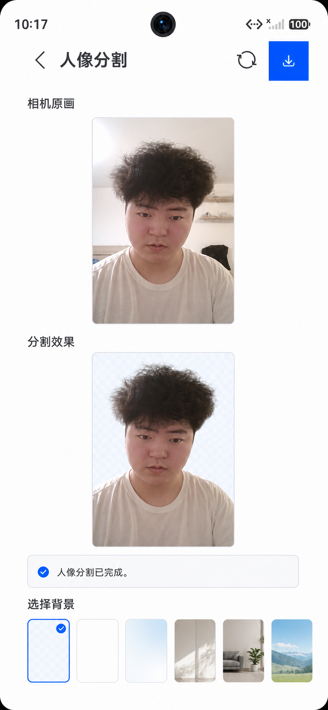

# 人像分割自适应预览设计

## 目标

- 页面不创建纵向 `Scroll`，避免再次出现上下滚动条。
- 相机原画与分割结果保持相同尺寸和方向，不拉伸、不旋转人物。
- 避免竖向前摄占满页面，同时兼容横向或外接摄像头。

## 布局

- 顶部工具栏和“相机原画”固定在现有位置。
- 当相机预览比例小于 1 时，两块预览使用 `3:4` 比例、父容器 `46%` 宽度并居中，与获批概念图一致。
- 当相机预览比例大于等于 1 时，两块预览使用 `4:3` 比例、父容器 `100%` 宽度。
- “分割效果”、状态栏和背景选择直接位于下方普通 `Column`，不再嵌套纵向滚动容器。
- 分割结果继续使用与相机相同的裁切和方向数据，不修改推理、保存或背景替换流程。

## 验证

- 静态守卫必须检查方向自适应宽度和纵向 `Scroll` 缺失。
- 负向突变必须证明恢复 `78%` 宽度或纵向滚动容器时守卫失败。
- DevEco 模拟器检查整页一次性显示双预览、状态和背景条；竖向前摄人物比例必须正常。

## 概念图

