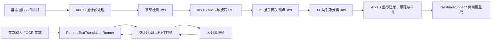

# HMS 手势识别与在线翻译鸿蒙等价移植设计

日期：2026-07-13
状态：待评审

## 1. 目标与“完整移植”的定义

本设计把 Android 版 HMS 手势识别与任意文本在线翻译的用户能力等价迁移到 HarmonyOS。目标是行为与交互对齐，不复制华为闭源 HMS SDK 的内部代码或模型。

完成态必须同时满足：

- 手势识别在设备端运行，支持相册/拍照静态图和相机实时流。
- 手势结果使用 Android 版的 14 个类别：`ONE`、`SECOND`、`THREE`、`FOUR`、`FIVE`、`SIX`、`SEVEN`、`EIGHT`、`NINE`、`DISS`、`FIST`、`GOOD`、`HEART`、`OK`。
- 返回并绘制每只手的类别、置信度和边界框，单帧最多 3 只手，与当前鸿蒙服务上限保持一致。
- 任意未预置的中文或英文文本可在线翻译；中文默认译为英文，其他输入默认译为中文，与 Android 版目标语言选择一致。
- 文本输入、相册 OCR、拍照 OCR、相机 OCR 得到的文本都走同一在线翻译入口。
- HAP 中不包含云服务 AK、SK、长期 Token 或其他可复用的服务端凭据。
- 模型缺失、网络失败、鉴权失败等情况明确报错，不用 ImageNet 标签、离线短语表或伪结果冒充成功。

“应用运行时用 ArkTS 重写”指预处理、后处理、跟踪、调度、接口调用、状态管理和 UI 集成均使用 ArkTS；神经网络权重通过离线训练/转换产生，由 MindSpore Lite 在设备端推理，不要求用 ArkTS 手写网络权重。

## 2. 已有行为基线

### 2.1 Android 手势识别

Android 版通过 HMS `MLGestureAnalyzer` 处理静态图片和实时相机帧，返回手势列表、类别和区域。移植后保留相同入口与结果语义，但推理实现替换为本地 MindSpore Lite 管线。

### 2.2 Android 在线翻译

Android 版通过 HMS `MLRemoteTranslator.asyncTranslate` 请求云端翻译：检测到中文时目标语言为英文，否则为中文。图片路径先执行 OCR，再把识别文本交给远程翻译器。

现有鸿蒙 `LocalTextTranslationRunner` 只是有限短语表，不能满足“任意文本在线翻译”，只能作为明确标注的开发/离线降级能力。

## 3. 方案选择

采用“设备端手势识别 + 安全翻译代理”的组合方案。

未采用以下方案：

- HAP 直接调用云翻译并内置 AK/SK：实现较快，但安装包可被提取，无法作为生产完成态。
- 全离线机器翻译：模型体积、语言覆盖和端侧资源成本显著增加，而且不符合“在线翻译”要求。
- 把普通图像分类模型标签映射成手势：结果语义错误，禁止作为降级方案。

## 4. 总体架构



现有 `GestureRunner` 和 `TextTranslationRunner` 继续作为页面与具体实现之间的边界。页面不直接依赖模型文件、MindSpore Lite 会话或云服务 SDK。

## 5. 手势识别设计

### 5.1 推理管线

每个待处理帧按以下顺序执行：

1. 解码像素，按模型要求完成缩放、填充、颜色通道转换和归一化。
2. 掌部检测模型输出候选框、关键点和分数。
3. ArkTS 执行阈值过滤、非极大值抑制和最多 3 手截断。
4. 根据掌部关键点计算带旋转的手部 ROI，并裁剪关键点模型输入。
5. 关键点模型输出 21 个手部关键点、手部存在分数和左右手信息。
6. 将关键点平移、尺度归一化并校正左右手方向后，交给 14 类分类器。
7. 把关键点和边界框还原到原图坐标，输出 `GestureDetection`。

分类器输入优先采用归一化的 `21 x 3` 关键点。与直接对整图分类相比，该输入对背景更不敏感，也便于训练和端侧运行。

### 5.2 静态与实时模式

静态模式每张图执行完整管线。实时模式遵守以下规则：

- 任一时刻最多处理一帧；推理未结束时丢弃新帧，避免请求堆积。
- 首帧、跟踪丢失或定期校准时运行掌部检测。
- 稳定跟踪期间以上一帧关键点推算 ROI，只运行关键点和分类器。
- 类别使用最近有效结果的加权平滑；连续低置信度时清除结果，不能无限保留旧类别。
- 页面退出、相机切换或新会话开始时递增 generation，旧异步结果不得回写 UI。

现有页面约 500 ms 的采样节奏可以作为第一阶段上限；完成验收需在目标真机上验证中位端到端单帧耗时不超过 500 ms，且无并发帧处理。

### 5.3 模型与数据

模型交付物包括：

- 掌部检测模型 `.ms`；
- 21 点手部关键点模型 `.ms`；
- 14 类手势分类器 `.ms`；
- 标签清单、输入输出张量契约、来源与许可证清单、SHA-256 清单。

开源掌部/关键点模型只有在许可证和再分发条件核验后才能加入仓库。所有模型先通过 MindSpore Lite 转换和目标设备 smoke test，再接入 UI。若某模型包含不支持的算子，先寻找可转换的开放模型或调整训练导出，不在应用中悄悄切回错误分类器。

14 类分类器必须使用与 Android 标签语义一致的数据训练。数据集划分必须按采集者隔离，避免同一人的相近帧同时进入训练集和测试集。

### 5.4 手势结果契约

`GestureRunner` 对外返回：

- 原图尺寸；
- 0 至 3 个检测结果；
- 每个结果的 Android 兼容类别、展示文案、置信度和归一化边界框；
- 可选的 21 点关键点与左右手信息，供调试或后续功能使用；
- 明确的 runtime source 和错误类型。

模型、标签或张量契约不匹配时初始化失败，并显示“手势模型不可用”及可诊断原因。

## 6. 在线翻译设计

### 6.1 应用侧

新增生产实现 `RemoteTextTranslationRunner`，职责为：

- 去除首尾空白并拒绝空文本；
- 复用现有中英文目标语言选择逻辑；
- 生成请求 ID，并通过 HTTPS 调用项目翻译代理；
- 设置 15 秒总超时；
- 只对网络中断、超时和 HTTP 5xx 最多重试一次；
- 对 4xx、鉴权失败、内容过长和响应格式错误不重试；
- 新请求、页面退出或 Ability 销毁后忽略旧响应；
- 把服务端错误转换成可理解且不泄露凭据的 UI 状态。

生产构建默认使用远程实现。有限短语表只能在显式开发开关或用户明确选择“离线短语”时启用，结果必须标注 `offlineDictionary`。

首次使用在线翻译前说明文本会发送到云端处理；日志不得记录完整原文和译文。

### 6.2 代理接口

应用只访问项目控制的接口：

```http
POST /v1/translate
Content-Type: application/json
X-Request-Id: <uuid>
```

请求：

```json
{
  "text": "待翻译文本",
  "targetLanguage": "en",
  "sourceLanguage": "auto"
}
```

成功响应：

```json
{
  "translatedText": "translated text",
  "sourceLanguage": "zh",
  "targetLanguage": "en",
  "requestId": "uuid",
  "providerRequestId": "optional"
}
```

错误响应使用稳定错误码，例如 `INVALID_TEXT`、`TEXT_TOO_LONG`、`UNSUPPORTED_LANGUAGE`、`RATE_LIMITED`、`PROVIDER_UNAVAILABLE` 和 `AUTH_MISCONFIGURED`，不得把上游密钥或原始鉴权头返回客户端。

代理负责：

- 从服务端密钥管理或环境变量读取云服务凭据；
- 获取/刷新 Token 或执行 AK/SK 请求签名；
- 校验文本大小和语言参数；
- 设置限流、请求超时和最小必要的脱敏审计；
- 将供应商响应规范化为上述稳定契约。

代理是服务端组件，建议使用 TypeScript 实现，但不打包进 HAP。鸿蒙客户端的请求、重试、取消、状态管理和 OCR 串联均由 ArkTS 自研实现；实际自然语言翻译能力来自已配置的云模型，而不是复制 HMS 的闭源翻译模型。

云账号开通、配额购买、区域 endpoint 和生产凭据属于部署配置，但代理代码、配置模板、健康检查和本地 mock 服务属于项目交付物。

### 6.3 OCR 串联

现有文本识别入口保持不变：OCR 成功后把合并文本交给同一个 `TextTranslationService`。OCR 无文字、翻译失败或请求被取消时分别显示独立状态，不能把 OCR 成功误报成翻译成功。

## 7. 配置与安全

应用构建配置只包含代理基础 URL、公开的客户端版本和非敏感功能开关。以下内容禁止进入 ArkTS、资源文件、构建日志和 HAP：

- 华为云或其他供应商 AK/SK；
- 可续期的长期 Token；
- 代理服务端管理密钥；
- 测试账号明文凭据。

CI 增加模型哈希/标签一致性校验和敏感字符串扫描。代理必须使用 HTTPS；生产环境应增加按设备或安装实例签发的短期访问凭证和速率限制，但该凭证不能等同于云供应商凭据。

## 8. 测试与验收

### 8.1 手势

自动化测试覆盖：

- 图像缩放/填充与坐标逆变换；
- IoU、NMS、最多 3 手截断；
- 旋转 ROI 与 21 点归一化；
- 14 类标签顺序和张量维度保护；
- 跟踪、平滑、丢失清除和 generation 取消；
- 固定测试图的模型 golden result；
- 模型缺失、哈希不符和不兼容时的诚实失败。

模型离线验收指标：按采集者隔离的留出集上宏平均准确率不低于 90%，每类召回率不低于 75%。真机验收覆盖 14 类、静态/实时、单双手、横竖屏、前后摄像头和常见明暗背景；实时模式单帧中位耗时不超过 500 ms，且不存在帧处理重叠。

### 8.2 翻译

应用使用本地 mock 代理进行契约测试，覆盖：

- 中文自动译英文、英文自动译中文；
- 任意未收录句子，而不是只测短语表；
- 直接文本、相册 OCR、拍照 OCR 和相机 OCR；
- 空输入、超长输入、15 秒超时、网络断开、4xx、5xx、限流、畸形响应；
- 一次重试规则、重复点击、页面退出和旧请求取消；
- 日志和打包产物无凭据、无完整原文/译文。

配置真实云账号后进行集成验收：至少各 20 条未预置中英文句子成功双向翻译，结果来自远程 runtime source，重启应用后仍可用。

### 8.3 完成门槛

只有以下条件全部满足才宣称“完整移植”：

1. 三个真实 `.ms` 模型随应用加载并通过标签、张量和哈希保护；
2. 14 类手势达到离线指标，并在目标 HarmonyOS 真机完成静态和实时验证；
3. 翻译代理已部署或在可复现的本地环境运行，任意新句子双向翻译通过；
4. 文本与 OCR 四条入口均通过，错误和生命周期路径无假成功；
5. 工程构建、单元测试、静态守卫、安装与启动验证全部通过；
6. HAP 与源码扫描确认不含云服务凭据。

## 9. 实施顺序与风险控制

实施按以下依赖顺序展开：

1. 先完成掌部/关键点模型许可证核验、MindSpore Lite 转换和真机张量 smoke test。
2. 并行定义翻译代理契约和本地 mock，完成 ArkTS 远程 runner 的契约测试。
3. 完成手势 ArkTS 预处理、NMS、ROI、后处理和静态图推理。
4. 加入实时跟踪、平滑和页面生命周期保护。
5. 训练、转换并校准 14 类分类器，执行离线指标验收。
6. 部署代理并接入真实云服务，执行双向翻译及 OCR 端到端验收。
7. 运行全量构建、测试、HAP 扫描和真机回归。

最大风险是可合法分发且可被当前 MindSpore Lite 运行时执行的掌部/关键点模型。该风险在 UI 大规模改动前通过转换和真机 smoke test 前置消除。云服务凭据缺失不会阻止代码与 mock 验证，但会阻止“真实在线翻译完成”的最终声明。

## 10. 参考依据

- HarmonyOS 开发文档入口：[华为开发者文档](https://developer.huawei.com/consumer/cn/doc/)
- 在线翻译 REST 能力：[华为云自然语言处理—文本翻译](https://support.huaweicloud.com/api-nlp/nlp_03_0024.html)
- Token 与 AK/SK 鉴权方式：[华为云自然语言处理—认证鉴权](https://support.huaweicloud.com/api-nlp/nlp_03_0050.html)
- 模型转换支持范围：[MindSpore Lite Converter](https://www.mindspore.cn/lite/api/zh-CN/master/mindspore_lite/mindspore_lite.Converter.html)
- 手掌检测、关键点和分类管线参考：[MediaPipe Gesture Recognizer](https://developers.google.com/edge/mediapipe/solutions/vision/gesture_recognizer/android)
