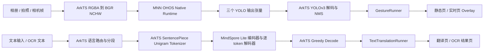

# HMS 手势识别与端侧中英翻译鸿蒙等价移植设计

日期：2026-07-13
状态：条件批准；翻译完整训练和生产装配受 ONNX→MindSpore smoke 门槛约束
适用范围：本地学习、私有仓库

## 1. 目标与范围

把 Android 工程中基于 HMS 的手势识别和文本翻译能力迁移到 HarmonyOS：

- 手势识别使用 Android HMS AAR 中的原始 `GestureDetector.ms` 模型，支持相册、拍照和实时相机流。
- 保持 Android 的 14 个公开手势类别、检测矩形、多目标结果以及静态/实时交互。
- 文本翻译改为完全端侧的中文和英文双向翻译，不使用自建服务、第三方在线接口或嵌入式密钥。
- 文本输入和 OCR 得到的文本复用同一个本地翻译入口。
- 模型文件允许提交到当前私有仓库，以保证开发和构建可复现。

“用 ArkTS 重写”定义为：业务接口、图像预处理、YOLO 解码、NMS、类别映射、tokenizer、翻译解码循环、异步调度、状态管理和 UI 集成都由 ArkTS 实现。神经网络矩阵计算仍由端侧推理运行时执行；HMS 手势文件是 MNN 模型，必须由 MNN Native Runtime 执行，不能用 ArkTS 手写卷积替代。

## 2. 已验证的 Android 行为

### 2.1 手势识别

Android 使用 `MLGestureAnalyzer` 处理静态图片和实时相机帧，返回零到多个手势结果。公开类别映射为：

| 模型类别 | Android 常量 | 展示语义 |
| ---: | --- | --- |
| 0 | `ONE` | 数字 1 |
| 1 | `SECOND` | 数字 2 |
| 2 | `THREE` | 数字 3 |
| 3 | `FOUR` | 数字 4 |
| 4 | `FIVE` | 数字 5 |
| 5 | `SIX` | 数字 6 |
| 6 | `SEVEN` | 数字 7 |
| 7 | `EIGHT` | 数字 8 |
| 8 | `NINE` | 数字 9 |
| 9 | `DISS` | 差评 |
| 10 | `FIST` | 握拳 |
| 11 | `GOOD` | 点赞 |
| 12 | `HEART` | 单手比心 |
| 13 | `OK` | 确认 |
| 14 或其他 | `UNKNOWN` | 其他手势 |

静态识别绘制所有结果；实时识别默认后置摄像头，支持前后摄像头切换，并在前置摄像头下镜像检测框。

### 2.2 文本翻译

Android 实际调用 `MLRemoteTranslator.asyncTranslate`，不是业务代码中的本地模型：

- 输入包含中文字符时，目标语言为英文。
- 其他输入的目标语言为中文。
- 图片路径先执行 OCR，再翻译 OCR 文本。

本次按用户确认把能力限定为中文和英文双向，但从云端改为完全本地模型。现有有限短语字典不得冒充模型翻译成功。

## 3. 总体架构



现有 `GestureRunner` 和 `TextTranslationRunner` 继续作为页面与运行时之间的稳定边界。页面不直接依赖模型文件、MNN 会话或 MindSpore Lite 张量。

## 4. HMS 手势模型方案

### 4.1 模型格式结论

`GestureDetector.ms` 的扩展名具有误导性。模型已通过 FlatBuffer 结构和随 AAR 原生库符号交叉验证，实际是 Alibaba MNN `Net`，不是 MindSpore Lite 模型。

因此：

- `@kit.MindSporeLiteKit` 不能加载该文件。
- Android AAR 中的现成 `.so` 不能直接复用，因为它依赖 Android bionic、`liblog.so`、`libjnigraphics.so` 和 JNI。
- 使用官方 MNN 源码为 OHOS arm64 构建 CPU Runtime，并提供最薄的 NAPI 桥。
- NAPI 只承担模型创建、张量拷贝和推理；可观察的预处理、后处理及类别语义仍由 ArkTS 控制。

### 4.2 精确张量协议

输入：

- 名称：`data`
- 类型：`float32`
- 布局：逻辑 NCHW，MNN 内部为 NC4HW4
- 默认形状：`[1, 3, 224, 224]`
- 原始 HMS 少数设备分支使用 `[1, 3, 192, 192]`；鸿蒙首版固定 224，以减少动态形状风险

预处理：

1. 原图直接拉伸至 224×224，不保留长宽比。
2. 使用 nearest-neighbor 采样。
3. 通道顺序转换为 BGR。
4. `mean = [0, 0, 0]`。
5. `normal = [1/255, 1/255, 1/255]`。

输出：

| 张量名 | 形状 | stride |
| --- | --- | ---: |
| `layer89-conv-hand` | `[1, 60, 7, 7]` | 32 |
| `layer101-conv-hand` | `[1, 60, 14, 14]` | 16 |
| `layer113-conv-hand` | `[1, 60, 28, 28]` | 8 |

每层 60 通道等于 `3 × (4 box + 1 objectness + 15 classes)`。

Anchors：

- stride 32：`(105,101)`、`(133,135)`、`(174,150)`
- stride 16：`(32,37)`、`(47,37)`、`(65,56)`
- stride 8：`(19,19)`、`(25,27)`、`(35,26)`

后处理使用标准 YOLOv3 sigmoid/anchor 解码：

- NMS IoU 阈值为 `0.45`。
- 静态图默认置信阈值为 `0.6`。
- 实时流固定使用 `0.1` 作为候选阈值；首版不增加额外时序平滑，页面继续按现有约 500 ms 节奏逐帧替换结果。
- 类别 0–13 映射到公开 HMS 类别；类别 14 映射到 `UNKNOWN`。
- Android 页面绘制 SDK 返回的全部结果，因此业务层不增加“最多 3 个”的截断；NMS 后按置信度降序、类别 ID、left、top 稳定排序。

模型仅含标准 MNN 算子，无自定义 Plugin/Extra 算子，因此标准 CPU Runtime 足以执行。

以上协议来自以下固定资产的 FlatBuffer 解析和 arm64 原生库反汇编，不是从页面代码猜测：

- AAR：`ml-computer-vision-gesture-model-2.1.0.300.aar`
- AAR SHA-256：`92FD6AE357E3C5B0407F8E0FED1644D7E01604F9399AF97F23E87C7D2F8CD01C`
- 模型 SHA-256：`A3440EF5B102BB9D25D984A8A2CA44EF4FC0557B65F0AC236176375FF9FFA5DA`
- 证据点：`MNNHandDetector::prepareImageData` 给出 BGR、nearest、mean/normal；`Yolov3AfterProcessor` 给出 anchors、sigmoid 解码、IoU 0.45 和调用模式阈值 0.6/0.1；MNN FlatBuffer 给出输入输出名称、shape 和算子集合。

实施时新增 `tools/model_inspect/verify_hms_gesture_model.py`，把上述哈希、张量名、形状、anchors 和算子白名单变成机器可重复检查；反汇编调查记录写入 `docs/model-provenance/hms-gesture-2.1.0.300.md`。

### 4.3 Native 边界

新增 `libgesture_mnn.so` 和 NAPI 模块，公开窄接口：

- `loadModel(modelBytes): GestureModelInfo`
- `predict(input: Float32Array): GestureRawOutputs`
- `release(): void`

ArkTS 在首次使用时加载单例会话；静态页与实时页共享模型实例。模型加载失败、张量名不匹配或输出维度错误时立即返回可诊断错误，不回退到图片分类器或伪结果。

MNN 构建契约已在本机真实编译和最小 NAPI 链接验证，固定为：

- MNN commit：`785907a83194f6607762742adab86240582aa013`，configure version 3.6.0
- DevEco SDK：6.1.1 / API 24
- OHOS Clang：15.0.4，LLVM commit `99548401bd80576251755b185ab95945e5fe7884`
- target/ABI：`aarch64-linux-ohos` / `arm64-v8a`
- CMake：Release、`OHOS_STL=c++_shared`、`MNN_BUILD_SHARED_LIBS=ON`、`MNN_SEP_BUILD=OFF`
- CPU only；tools、converter、train、test、benchmark、OpenCV、LLM、OpenCL、Vulkan、ARM82、BF16、logcat、KleidiAI、MINI 全部关闭

实测 `libMNN.so` 为 3,409,904 bytes，SHA-256 `A0D9F3BFBF5F97093438EA9E3D17AC8710F742228074A4E16C6196FE4AEC53A5`，只依赖 `libc++_shared.so` 和 `libc.so`。最小 NAPI probe 为 13,848 bytes，SHA-256 `025B8833A3DFAE3E0ABBC16266F4AFE20B6CDB3A38094CCAAEFDBC91DB164AE2`，已成功链接 `MNN::Interpreter::createFromFile`，依赖 `libMNN.so`、`libace_napi.z.so`、`libc++_shared.so` 和 `libc.so`。

可重复 CMake cache 命令为：

```powershell
cmake -S $MNN_SRC -B $BUILD -G Ninja `
  "-DCMAKE_TOOLCHAIN_FILE=$SDK_NATIVE/build/cmake/ohos.toolchain.cmake" `
  -DCMAKE_BUILD_TYPE=Release -DOHOS_ARCH=arm64-v8a `
  -DOHOS_PLATFORM_LEVEL=24 -DOHOS_STL=c++_shared `
  -DMNN_BUILD_SHARED_LIBS=ON -DMNN_SEP_BUILD=OFF `
  -DMNN_BUILD_TOOLS=OFF -DMNN_BUILD_CONVERTER=OFF `
  -DMNN_BUILD_TRAIN=OFF -DMNN_BUILD_TEST=OFF `
  -DMNN_BUILD_BENCHMARK=OFF -DMNN_BUILD_OPENCV=OFF `
  -DMNN_BUILD_LLM=OFF -DMNN_OPENCL=OFF -DMNN_VULKAN=OFF `
  -DMNN_ARM82=OFF -DMNN_SUPPORT_BF16=OFF -DMNN_USE_LOGCAT=OFF `
  -DMNN_KLEIDIAI=OFF -DMNN_BUILD_MINI=OFF
cmake --build $BUILD --target MNN -j 8
```

生产构建脚本必须重现上述 CMake cache，并校验产物架构与依赖。首版不启用 `MNN_BUILD_MINI` 或算子裁剪；只有 Android/Harmony golden 全部通过后才允许单独评估裁剪。另构建 `x86_64` 仅用于模拟器功能 smoke，不作为性能验收产物。

## 5. 本地中英翻译模型方案

### 5.1 单一逻辑模型

以 `Helsinki-NLP/opus-mt_tiny_zho-eng` revision `4ee3a9342aae4ca6fbae82c930b5dccff5dd68dd` 的 tiny Marian checkpoint 初始化。固定结构为：6 层 encoder、2 层 decoder、`d_model=256`、FFN 1536、8 attention heads、head dimension 32、共享 embedding。该公开 checkpoint 约 25.36M 参数，只支持中文到英文；官方 weight-only INT8 TFLite 文件为 20,144,264 bytes，SHA-256 为 `DCCA1B5F98AF1787CF7047799BD446BFFAADB04246D706FB19867555E3DE5EEB`。

该 TFLite 已真实解析和转换测试：它包含 `encode`、`prefill`、`decode` 三个固定 256-token 子图，但 MindSpore Lite 2.7/2.8 converter 均因 `EMBEDDING_LOOKUP`、`SELECT/SELECT_V2`、`REDUCE_ALL` 和 `DYNAMIC_UPDATE_SLICE` 等 TFLite parser 缺失而失败，Harmony `MindSporeLiteKit` 也不能直接加载 TFLite。因此它只作为架构、权重初始化和张量行为基线，不作为最终运行资产。

双向 checkpoint 是独立的前置里程碑，不假设它已经存在。完成定义如下：

- 数据集：`Mxode/BiST` revision `aca6be897afc319f779009379c8b849c1eb8d63e`，CC-BY-SA-4.0。
- `<2en>` 样本来自 config `zh-en`，source=`text_zh`、target=`text_en`；`<2zh>` 样本来自 config `en-zh`，source=`text_en`、target=`text_zh`。
- 每个方向在固定 revision 的 shard 字典序中流式读取；执行 `nmt_nfkc`、长度 3–120 token、空值过滤和规范化文本去重。
- 对 UTF-8 `source + "\0" + target` 计算 SHA-256，把十六进制摘要前 8 个字符按无符号 32 位大端整数解析，以该值 `% 20` 分配：0 为 test、1 为 validation、其余为 train；每方向分别收满 90,000 train、5,000 validation、5,000 test 后停止。
- seed 固定为 `20260713`；中→英和英→中以 1:1 batch 交替采样。
- 从上述 tiny checkpoint 加载权重，扩展两个方向 embedding，并用 seed `20260713`、normal(0, 0.02) 初始化新行；FP16 训练，AdamW，learning rate `3e-5`，weight decay `0.01`，label smoothing `0.1`，warmup 1,000 steps，单卡 batch 32、gradient accumulation 4、effective batch 128。
- 最多训练 4 epochs 或 12 个 RTX 2070 GPU 小时，以先到者为准；每 1,000 steps 评估，validation loss 连续两次不改善即 early stop；保存 validation loss 最低的 checkpoint。
- 不再引入未固定的教师模型。BiST 本身是合成双向平行语料；若上述预算内质量不达标，模型里程碑判定失败并调整训练定义，不暗中切回云服务或字典。

“一个翻译模型”指上述单一双向 checkpoint 和一个版本化模型包。为了高效自回归推理，导出为 `encoder.ms`、`decoder_prefill.ms`、`decoder_step.ms` 三个计算图；三图共享同一 manifest、词表、版本和哈希，不作为三个语言模型管理。checkpoint 生成、ONNX→MindSpore 转换和桌面 benchmark tensor smoke 全部成功之前，不开始页面生产装配。

### 5.2 ArkTS 推理流程

Tokenizer 固定为基线 `source.spm` 的 SentencePiece Unigram，不再混用“BPE”表述：

- `source.spm` 与 `target.spm` 内容相同，均为 755,175 bytes，SHA-256 `E5528A5C3685D08F8868902D31FEBEB763EEA8519F9997F43B05964B02554640`
- `vocab.json` 为 776,356 bytes，SHA-256 `13690D04E27310A43F0D879DFD38823C317E9AC69F436754BAFFBB0DA6FC9DBE`
- normalizer：`nmt_nfkc`
- `add_dummy_prefix=true`
- `remove_extra_whitespaces=true`
- `escape_whitespaces=true`
- 原始 pieces：32,000
- `EOS=0`、`UNK=1`、`PAD/decoder_start=32000`
- 新增 `<2en>=32001`、`<2zh>=32002`，由 ArkTS 在 SentencePiece 编码后手工前置，不要求 `.spm` 自行切出方向 token
- 最终 vocab size：32,003；没有独立 BOS，decoder 以 `PAD=32000` 启动

输入方向完全复刻 Android `StringUtils.isChinese` 的宽泛范围：只要文本包含 `U+4E00–U+9FA5`、`U+FF00–U+FFEF`、`U+2E80–U+2EFF`、`U+3000–U+303F` 或 `U+31C0–U+31EF` 中任一字符，就添加 `<2en>`；否则添加 `<2zh>`。因此混合中英文本和全角标点会路由到英文，纯 ASCII 标点会路由到中文。全空白输入直接报空，不进入模型。

每个 chunk 的 encoder 长度固定为 128，包含方向 token 和 EOS；超过 128 时优先按换行、中文句末标点、英文句末标点、空格逐级切分，仍超长才按 token 硬切。分隔符归属前一个 chunk，原始换行数量和顺序在结果拼接时保持。decoder 最多生成 128 token，遇到 EOS 立即停止。

推理步骤：

1. 执行上述规范化、语言路由、分段、SentencePiece 编码、padding 和 mask 构造。
2. `encoder.ms` 每个 chunk 运行一次。
3. `decoder_prefill.ms` 使用 `PAD=32000` 生成首 token logits 和 2 层 self/cross KV cache。
4. ArkTS 对 32,003 logits 执行稳定 argmax；相同值取最小 token ID。
5. `decoder_step.ms` 使用上一个 token、position 和 cache 循环，直到 EOS 或 128 token。
6. SentencePiece 解码并按原始分隔结构拼接。
7. 新请求到来或页面销毁时递增 generation；旧推理结果不得回写 UI。

模型和 tokenizer 由 `MindSporeLiteTextTranslationRunner` 单例缓存。张量契约固定如下，导出脚本必须用这些名称，manifest 和运行时同时校验：

`encoder.ms`：

- inputs：`input_ids INT32 [1,128]`、`attention_mask FLOAT32 [1,128]`
- output：`encoder_hidden_states FLOAT32 [1,128,256]`

`decoder_prefill.ms`：

- inputs：`decoder_input_ids INT32 [1,1]`、`decoder_position INT32 [1]`、`encoder_hidden_states FLOAT32 [1,128,256]`、`encoder_attention_mask FLOAT32 [1,128]`
- outputs：`logits FLOAT32 [1,1,32003]`，以及每层 `present_self_key_{0,1}`、`present_self_value_{0,1}`、`present_cross_key_{0,1}`、`present_cross_value_{0,1}`，每个 cache 均为 `FLOAT32 [1,8,128,32]`

`decoder_step.ms`：

- inputs：`decoder_input_ids INT32 [1,1]`、`decoder_position INT32 [1]`、`encoder_attention_mask FLOAT32 [1,128]`，以及上一步 8 个 `past_*` cache，均为 `FLOAT32 [1,8,128,32]`
- outputs：`logits FLOAT32 [1,1,32003]`，4 个更新后的 self `present_*` cache；cross cache 由 ArkTS 保留并复用
- cache 使用固定 128 槽，`decoder_position` 指定写入位置；padding 槽必须为 0，self-attention mask 禁止读取未来槽位

上述三个 ONNX 图必须在完整训练开始前通过 MindSpore converter 与桌面 benchmark smoke。原型同时执行 8-bit weight quantization 并记录三个 `.ms` 的总大小；若按最终 32,003 vocab 推算明显超过 35 MiB，必须先解决重复 embedding/LM head/decoder 权重或重新设计单包共享结构，不能把体积问题推迟到完整训练后。若固定 cache 更新仍产生不支持算子，本设计的翻译里程碑失败并重新评审图结构；不允许在实施中静默改成另一套 Native runtime。

### 5.3 训练和导出交付物

仓库内允许包含：

- `translation/encoder.ms`
- `translation/decoder_prefill.ms`
- `translation/decoder_step.ms`
- `translation/tokenizer.model`
- `translation/vocab.json`
- `translation/manifest.json`
- `translation/LICENSES.md`
- `translation/SHA256SUMS`

同时提供可复现脚本：

- 固定 revision 数据准备、过滤、去重、分割与双向样本生成
- 按上述超参数训练并输出 metrics/checkpoint manifest
- 导出三个固定张量契约的 ONNX 中间图
- 转换 MindSpore Lite
- 量化、哈希和张量契约检查

三个图统一使用 MindSpore Lite 2.8 fixed-bit weight quantization：

```ini
[common_quant_param]
quant_type=WEIGHT_QUANT
bit_num=8
min_quant_weight_size=0
min_quant_weight_channel=16
enable_encode=true

[weight_quant_param]
per_channel=true
bias_correction=false
```

先保留未量化 `.ms` 做数值对照；量化图在固定 100 条转换校准句上与未量化图逐 token argmax 一致率必须不低于 99%，否则量化里程碑失败。最终 HAP 只打包量化图。

大规模临时数据不提交；最终学生 checkpoint 的训练 manifest、三个 `.ms`、运行时 tokenizer 资产和质量报告提交。公开 tiny TFLite 因转换失败不进入 HAP。

## 6. 代码结构

建议新增或调整：

```text
entry/src/main/ets/
  ai/gesture/
    HmsGestureModelRunner.ets
    HmsGesturePreprocessor.ets
    HmsGestureYoloDecoder.ets
    HmsGestureNms.ets
  ai/translation/
    TinyTranslationTokenizer.ets
    MindSporeLiteTextTranslationRunner.ets
    TranslationModelManifest.ets
  native/gesture_mnn/
    index.d.ts

entry/src/main/cpp/gesture_mnn/
  CMakeLists.txt
  gesture_mnn_napi.cpp
  gesture_mnn_runtime.cpp

entry/src/main/resources/rawfile/models/
  gesture/GestureDetector.ms
  translation/...
```

现有 `GestureService`、`TextTranslationService`、OCR 串联、实时帧互斥、请求 generation 和页面 Overlay 尽量复用，只替换生产运行时装配。

## 7. 状态、错误与生命周期

- 模型首次加载显示初始化状态，不阻塞 UI 主线程。
- 同一时刻只执行一个实时手势帧；繁忙时丢弃新帧，避免请求堆积。
- 相机切换、页面退出和新请求开始时作废旧 generation。
- 翻译空输入给出明确提示，不启动模型。
- 本地翻译不需要 `INTERNET` 权限；若工程其他功能需要网络，不因此全局删除。
- 模型缺失、哈希错误、张量不匹配、Native 加载失败和推理失败分别记录稳定错误码。
- 日志不记录完整原图、OCR 原文或完整翻译文本。

## 8. 测试与验收

### 8.1 手势自动化测试

- RGBA→BGR、nearest resize 和 `/255` 归一化 golden。
- 三层张量布局、sigmoid/anchor 解码和坐标逆变换。
- IoU、类别内 NMS、静态/实时置信阈值、稳定排序和“不做业务层数量截断”。
- 15 个模型类别到 14 个公开类别加 `UNKNOWN` 的映射。
- 模型缺失、哈希错误和张量协议错误的诚实失败。
- 静态页、拍照页和实时页均装配真实 `HmsGestureModelRunner`。
- 实时帧互斥、前置镜像、相机切换和过期结果丢弃。
- `test/resources/gesture_golden/` 固定至少 20 张真实静态图和 5 段视频帧序列，覆盖无手、单手、多手、14 类、明暗背景和边缘框；对应 Android 2.1.0.300 基线 JSON 与原资产一起版本化。
- 对远离阈值边界的 golden：结果数量和排序完全一致，类别完全一致，置信度绝对误差不超过 `0.02`，对应矩形 IoU 不低于 `0.90`。置信度落在阈值 ±0.02 的样本标记为 borderline，不用于数量一致性门槛。
- 静态无结果显示“未检测到手势”并清除旧框；实时空帧只清框、不弹 Toast；前置镜像后的框必须仍与预览对齐。

### 8.2 翻译自动化测试

- tokenizer 的中文、英文、混合标点、BOS/EOS、方向前缀和截断 golden。
- 中文新句译英文、英文新句译中文，证明结果不是有限字典。
- decoder EOS、最大 token 限制、非法 token 和张量协议错误。
- 长文本分段和换行保持。
- 文本输入与 OCR 文本走同一模型 runner。
- 模型只加载一次；旧请求不得覆盖新请求。
- 翻译工作流不声明或显示“需要联网”。
- 方向路由覆盖混合中英、全角标点、纯 ASCII 标点和空白输入，并与第 5.2 节的 Android Unicode 范围一致。
- 静态手势页的相册、拍照、实时三个入口；相册 EXIF 方向修正；默认后置摄像头；单摄像头隐藏切换按钮。
- 相机普通拒绝、永久拒绝、跳转设置页后恢复，以及取消 Picker 后恢复原 UI。
- 文本翻译结果复制；相册/拍照 OCR 完成后自动本地翻译；OCR 无文本、OCR 失败和翻译失败显示不同状态。
- 关闭 Wi-Fi 和蜂窝网络后，中英双向文本及 OCR 翻译仍通过，证明没有在线依赖。

### 8.3 模型质量与端侧验收

固定外部测试集为 `openlanguagedata/flores_plus` revision `b3a5298db5721c8a682e7ef00a37fcc9ab522757` 的 `devtest`，语言为 `zho_Hans` 与 `eng_Latn`，不得用于训练或 early stopping。

指标使用 sacreBLEU 2.4.3：

- 中→英 BLEU：`case:mixed|eff:no|tok:13a|smooth:exp|version:2.4.3`，门槛 `>=19.0`。
- 中→英 chrF2：`case:mixed|eff:yes|nc:6|nw:0|space:no|version:2.4.3`，门槛 `>=49.0`。
- 英→中 BLEU：`case:mixed|eff:no|tok:zh|smooth:exp|version:2.4.3`，门槛 `>=17.0`。
- 英→中 chrF2：同上 chrF2 signature，门槛 `>=40.0`。

人工集每方向固定 50 条未参与训练的句子：10 条日常、10 条技术/UI、10 条长句、10 条数字/专名/标点、10 条 OCR 噪声。每条必须同时满足“核心语义保留、无核心分句漏译、无新增事实”；每方向至少 45/50 通过，且数字、URL 和专名不得出现致命篡改。

参考性能设备固定为 Huawei Mate 60 Pro 12 GB、HarmonyOS 6.x/API 24：

- 翻译模型运行资产总大小不超过 35 MiB。
- 首次加载不超过 3 秒；已加载后 32 个输出 token 的单句总延迟不超过 5 秒。
- 翻译推理相对空闲页峰值 RSS 增量不超过 250 MiB。
- 手势静态单帧不超过 500 ms；实时模式保持 500 ms 采样上限且不存在并发帧。

若验收机器不可获得，对应性能项保持未完成，不用模拟器数据替代真机结论。模拟器只验证安装、启动、入口和可控失败态；arm64 真机验证 MNN 推理、实时摄像头、本地翻译和离线行为。最终运行全量 Hypium、HAP 构建、安装和启动 smoke test。

## 9. 资产和许可

项目仅用于本地学习且仓库为 private，用户已明确允许模型进入仓库。仍需为每个资产记录来源、版本、SHA-256 和上游许可/声明：

- HMS `GestureDetector.ms` 来源于官方 `ml-computer-vision-gesture-model:2.1.0.300` AAR。
- MNN Runtime 固定到第 4.3 节 commit，使用 Apache-2.0。
- OPUS-MT tiny revision 固定到第 5.1 节，模型卡声明 Apache-2.0。
- BiST revision 固定到第 5.1 节，使用 CC-BY-SA-4.0；原始训练数据不提交仓库。
- FLORES+ 仅用于测试，使用 CC-BY-SA-4.0。

若仓库将来改为公开或应用需要发布，必须重新进行 HMS 模型再分发许可审查；该变化不在本次本地学习范围内。

## 10. 实施顺序

1. 记录已完成的 MNN OHOS/NAPI probe，建立仓库内可重复构建脚本和 Native 张量 smoke test。
2. 将 HMS 模型及 manifest 加入资源，完成 ArkTS 预处理、YOLO 解码与 NMS 单元测试。
3. 接入静态手势页，再接入实时相机流并做 Android 对照。
4. 先用固定 tiny checkpoint 导出三个 ONNX 原型并执行 ONNX→MindSpore tensor smoke；失败则在训练前修订图结构，不投入完整训练。
5. 按第 5.1 节生成双向 checkpoint，执行质量门槛、导出、量化、哈希和桌面 benchmark；此里程碑通过后才装配翻译生产 runtime。
6. 完成 tokenizer 与 encoder/prefill/decode ArkTS runner 的测试和实现。
7. 把文本输入和 OCR 翻译统一切换到本地模型。
8. 执行全量测试、HAP 构建、模拟器和 arm64 真机验收。

## 11. 主要风险与控制

- MNN OHOS 构建或 NAPI ABI 不兼容：工具链和 probe 已验证；模型张量 smoke 仍前置，不先改大面积 UI。
- 翻译模型转换含不支持算子：公开 tiny TFLite→MindSpore 已确认失败；正式路径只采用自定义固定契约 ONNX 图，并在完整训练前完成 converter smoke。
- 双向学生质量不足：使用固定方向 token、1:1 混合采样和第 5.1 节 early-stop 规则；质量未达标时模型里程碑失败，不回退短语字典。
- 模型包过大：优先量化、共享词表和共享权重；不得通过删除一个翻译方向伪造达标。
- 模型资产可再分发性变化：保持来源和哈希清单，并在仓库公开/发布前重新审查。
